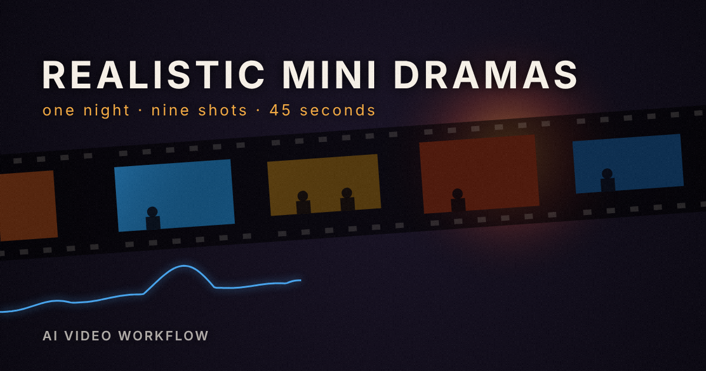

# Realistic Mini Dramas

Create original mini dramas in VideoExpress with locked characters, dialogue, screen direction and prop continuity.



**Community:** [Realistic Mini Dramas Workflow](https://community.dualup.com/@videoexpress/workflows/realistic-mini-dramas-workflow)

## Start here

1. Sign in to VideoExpress in a dedicated browser tab.
2. Copy [SYSTEM_PROMPT.md](SYSTEM_PROMPT.md) into a Claude or ChatGPT session with browser tools.
3. Provide a premise, two fictional adult characters (or ask the producer to write them), and a spend ceiling.
4. Review the shot plan and prompts. The producer audits the live controls and asks for approval before generation.
5. Review each generated clip before assembly and export.

The default prompt makes **four shots, 24–32 seconds, 16:9**. The thumbnail illustrates the separate **nine-shot, 45-second** Hold the Line variants. Those variants are example packs, not the default prompt's output specification.

## Files

| File or folder | Purpose |
|---|---|
| [SYSTEM_PROMPT.md](SYSTEM_PROMPT.md) | Copy-ready producer instructions |
| [docs/community-entry.md](docs/community-entry.md) | Full guide, steps, examples and limitations |
| [examples/returned-key](examples/returned-key) | Four-shot dialogue planning example |
| [examples/farmer-zombie](examples/farmer-zombie) | Hold the Line: landscape, eight shots |
| [examples/farmer-zombie-v2](examples/farmer-zombie-v2) | Hold the Line: vertical, nine shots, 45 seconds |
| [examples/farmer-zombie-v3-3d](examples/farmer-zombie-v3-3d) | Vertical 3D-cartoon variant |
| [docs/run-report.md](docs/run-report.md) | Reported generation/export observations and pending QA |
| [skills/realistic-mini-dramas](skills/realistic-mini-dramas) | Extended continuity, QA and recovery instructions |
| `src/`, `schemas/`, `tests/` | Optional local planning and validation tools |

## Optional local checks

Requires Python 3.10 or newer. Run from this repository:

```bash
./mini-drama validate examples/returned-key
./mini-drama plan examples/returned-key --dry-run
./mini-drama privacy-scan
python3 -m unittest discover -s tests -v
```

The CLI plans locally with no spend; its real provider adapter is disabled. `jsonschema` is optional. Media-intake tests use ffmpeg/ffprobe when available. Local `.state/` output is ignored by Git and must not be published; run the privacy scan on a clean package.

## Evidence and limits

The supplied run report records three Hold the Line pilots generated and exported on 2026-10-23. Only first frames were checked; **motion, dialogue and lip-sync rubric QA are unfinished**. This repository publication did not rerun generation or inspect those output videos. Output videos are not bundled.

The exact model label and credit cost were not visible in the reported UI. The default prompt records a hidden vendor model as unknown and uses the live workflow. Exact-model requests still pause generation if unverified. Hidden prices require explicit bounded operation-count approval; they are never treated as free. Prompt constraints do not guarantee stable identities, props or voices.

Example projects are templates: previous approvals do not authorize new generations. Reconfirm references, model, costs and approvals for each run. Keep private media, credentials and signed download links out of Git. Leave public-gallery sharing off unless separately requested.

## Browser startup (v0.3)

In ChatGPT, select the connected Chrome capability (`@Chrome`) when you want to use your own browser. The prompt cannot add a missing browser tool. It distinguishes connection failure, a site login page, and hidden model metadata; it continues drafting while access is repaired. Sign in to VideoExpress in the bound tab, then say “Resume the live form audit.”

[Official OpenAI browser setup guidance](https://developers.openai.com/training/walkthroughs/using-your-computer-and-browser). See [browser regression report](docs/browser-regression.md) for what was and was not tested.
